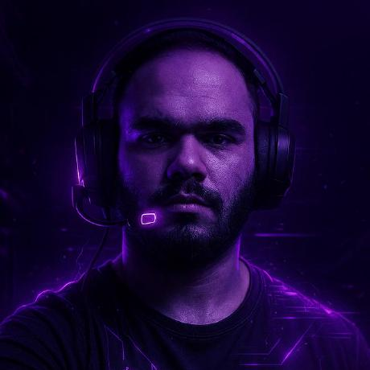

<div align="center">

# 📸 Headshot Studio

**Turn any selfie into a professional studio headshot — in about 30 seconds.**

Upload one photo · pick a look · download a LinkedIn-ready portrait that still looks like *you*.

[](https://nextjs.org)
[](https://www.typescriptlang.org)
[](https://platform.openai.com/docs/guides/image-generation)
[](LICENSE)

[](https://vercel.com/new/clone?repository-url=https://github.com/heshamhussin961-design/headshot-studio&env=OPENAI_API_KEY&envDescription=OpenAI%20API%20key%20with%20image%20access)

</div>

---

## 🔁 Before → After

<div align="center">

| Original selfie | Corporate headshot |
|:---:|:---:|
|  |  |

</div>

## ✨ Features

- **Identity-preserving** — the prompt locks face, skin tone, hairline and age; no "beauty filter" drift.
- **4 looks** — Corporate · LinkedIn · Editorial dark studio · City golden hour.
- **No sign-up, no storage** — the photo goes to the model and back; nothing is saved.
- **Drag & drop**, mobile-friendly UI, one-click download.
- **Tiny codebase** — one page + one API route. Easy to fork and rebrand.

## 🚀 Run locally

```bash
git clone https://github.com/heshamhussin961-design/headshot-studio.git
cd headshot-studio
npm install
cp .env.example .env.local   # add your OPENAI_API_KEY
npm run dev                  # http://localhost:3000
```

## ⚙️ Configuration

| Variable | Required | Default | Notes |
|---|---|---|---|
| `OPENAI_API_KEY` | ✅ | — | Needs access to the image model |
| `OPENAI_IMAGE_MODEL` | | `gpt-image-1` | Any OpenAI model that supports `/v1/images/edits` |
| `OPENAI_IMAGE_QUALITY` | | `high` | `low` / `medium` / `high` — trades cost for detail |

## 🧠 How it works

```
Browser ──(photo + style)──▶ /api/generate ──▶ OpenAI images/edits ──▶ PNG ──▶ Browser
```

The API route validates the upload (type, ≤ 8 MB), builds an identity-locked prompt for the chosen look, and returns the generated image as a data URL.

## 📷 Tips for the best result

- Face the camera, good front light, no sunglasses or heavy filters.
- One person in the frame, face clearly visible.
- Higher-resolution source photo = sharper headshot.

## 📄 License

MIT © [Hussein Hesham](https://github.com/heshamhussin961-design)
